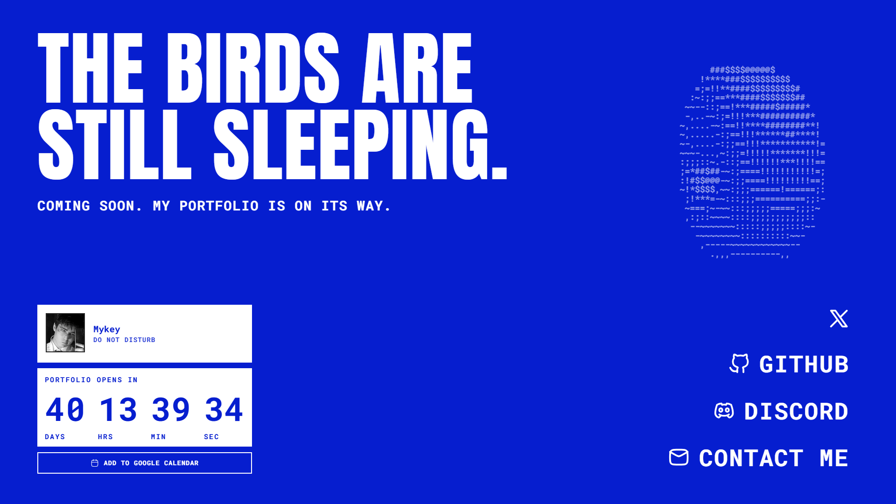
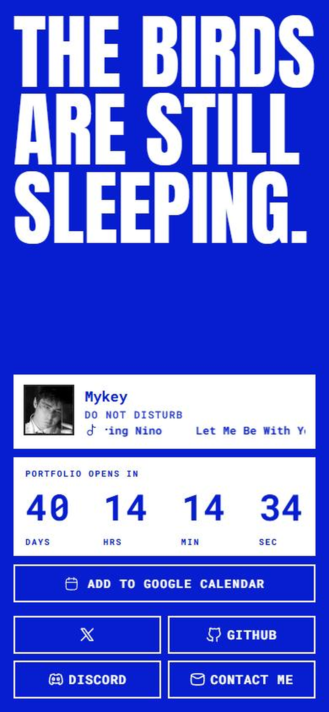
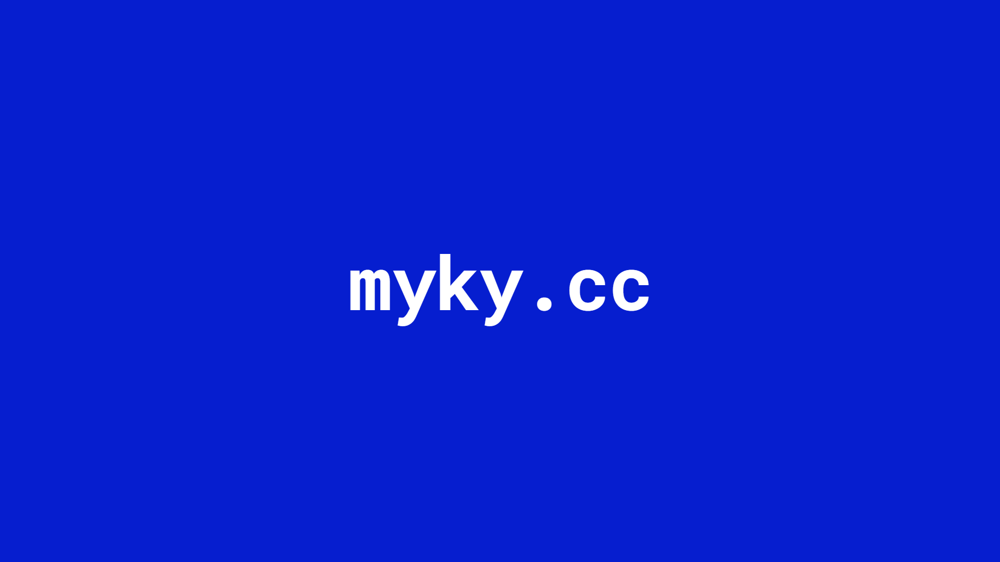
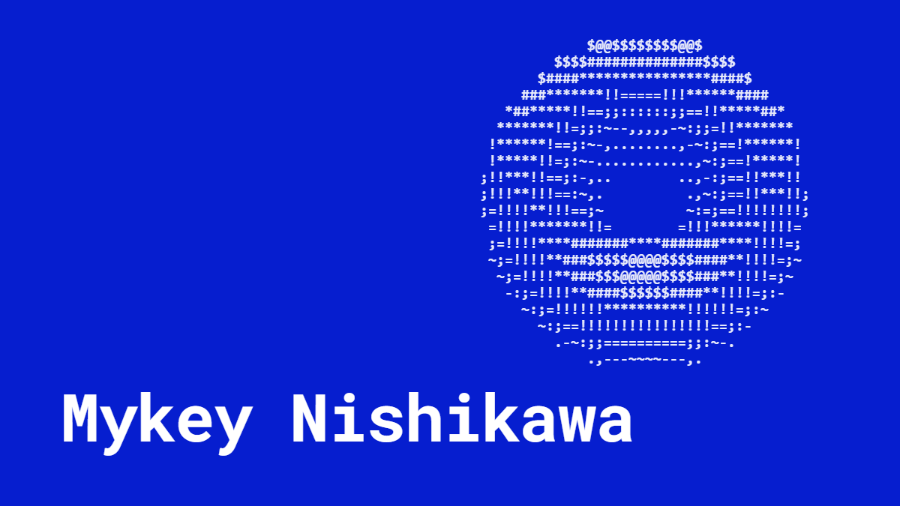

<div align="center">

# MYKY.CC

### THE BIRDS ARE STILL SLEEPING.

Coming soon. My portfolio is on its way.

<br>



</div>

<br>

## What this is

The placeholder for [myky.cc](https://myky.cc) while the real portfolio gets built. One HTML file, no build step, no dependencies to install.

It tells visitors two things: the site isn't ready, and exactly when it will be. Everything else on the page is a way to reach me in the meantime.

**Portfolio opens: December 8, 2026, 00:00 Philippine time.**

<br>

## On the page

| | |
|---|---|
| **Intro** | `myky.cc` types itself out on a blue screen, then the screen lifts away. Plays once per visit. Click or press any key to skip. |
| **Headline** | The words rise into place one after another when the intro lifts. |
| **Countdown** | Days, hours, minutes, and seconds to launch. Digits roll over on the second. |
| **Discord status** | My live Discord presence: whether I'm online, and the song or game I'm in. Long titles scroll like an MP3 player. |
| **Reminder** | One tap adds the launch to Google Calendar. |
| **Links** | X, GitHub, Discord, and email. A white bar slides in behind each one on hover. |
| **Donut** | A spinning ASCII donut in the empty space. Because. |

<br>

## Built to fit one screen

No scrolling, on anything. The layout is sized from the space it has, not from a list of device widths.

<table>
<tr>
<td width="60%" valign="top">

- **Desktop** (1024px and up): headline top-left, donut beside it, Discord card and countdown bottom-left, links bottom-right. The links stretch to exactly the height of the column beside them.
- **Phones and tablets**: one column. The headline grows until it spans the same width as the cards. Links become four tappable buttons.
- Tested from 320 &times; 568 up to 2560 &times; 1440.
- Sized with `svh`, so it stays still when a phone's browser bars slide away.
- Respects reduced-motion settings: no typing, no wipe, no rolling digits, a still donut.

</td>
<td width="40%" valign="top">



</td>
</tr>
</table>

<br>

## Look

<table>
<tr>
<td width="50%" valign="top">



</td>
<td width="50%" valign="top">

**One blue, one white.**

`#061ecf` and `#ffffff`. No gradients, no glows, no other colors.

**Two typefaces.**

[Anton](https://fonts.google.com/specimen/Anton) for the headline.
[Roboto Mono](https://fonts.google.com/specimen/Roboto+Mono) Bold for numbers, labels, and links.

**One icon family.**

[HugeIcons](https://hugeicons.com), drawn in a single stroke style.

</td>
</tr>
</table>

<br>

## Link preview

Paste `myky.cc` into Discord, X, iMessage, or Slack and it unfurls into a card: a blue edge (Discord paints it from `theme-color`), the title **Mykey Nishikawa**, and a 16:9 image of the name beside a face-on ASCII donut.

<div align="center">



</div>

- The image is [`og.png`](og.png), 1200 &times; 675. Its source is [`assets/og.html`](assets/og.html): open it in a browser and screenshot it at that size, or render it with headless Chrome.
- The tags live in the `<head>` of [`index.html`](index.html). They point at `https://myky.cc/og.png`, so `og.png` has to be served from the site root when the page goes live.
- Discord and X cache previews. If you change the image, post the link with a throwaway query string (`https://myky.cc/?v=2`) to see the new one.

<br>

## About me

I'm Mykey Nishikawa, an independent developer and designer based in the Philippines.

This page is the whole site for now. The portfolio, the work, and the rest of the story land on launch day.

<br>

## Say hi

| | |
|---|---|
| **X** | [@mykeycc](https://x.com/mykeycc) |
| **GitHub** | [mykeyy](https://github.com/mykeyy) |
| **Discord** | `mykey.e` |
| **Email** | [hello@mykeyy.tech](mailto:hello@mykeyy.tech) |

<br>

## Run it

It's a single file. Open `index.html` in a browser.

Or serve it locally:

```bash
npx serve .
```

One URL flag is useful while working on it:

| Add to the URL | What it does |
|---|---|
| `?intro` | Plays the intro again, even if you've already seen it this session. |

<br>

## Make it yours

Everything to change is near the top of the script in [`index.html`](index.html):

| Setting | Where |
|---|---|
| Launch date and time | `OPENS_AT` |
| Discord user ID | `DISCORD_ID` |
| Links and email | the `<nav>` block near the bottom of the page |
| Colors | `--ink` and `--paper` in `:root` |

The Discord card is powered by [Lanyard](https://github.com/Phineas/lanyard). To make it show your status, join the [Lanyard Discord server](https://discord.gg/lanyard) with the account you're tracking. If the status can't be fetched, the card simply stays hidden.

<br>

## What's in the folder

```
index.html     the whole site
og.png         the link-preview image (serve it next to index.html)
PRODUCT.md     what the page is for, its tone, and what it avoids
assets/        screenshots for this README, and og.html, the source of og.png
.claude/       design notes for working on the page with Claude Code
.impeccable/   design-check settings
```

<br>

<div align="center">

**See you on December 8.**

</div>
